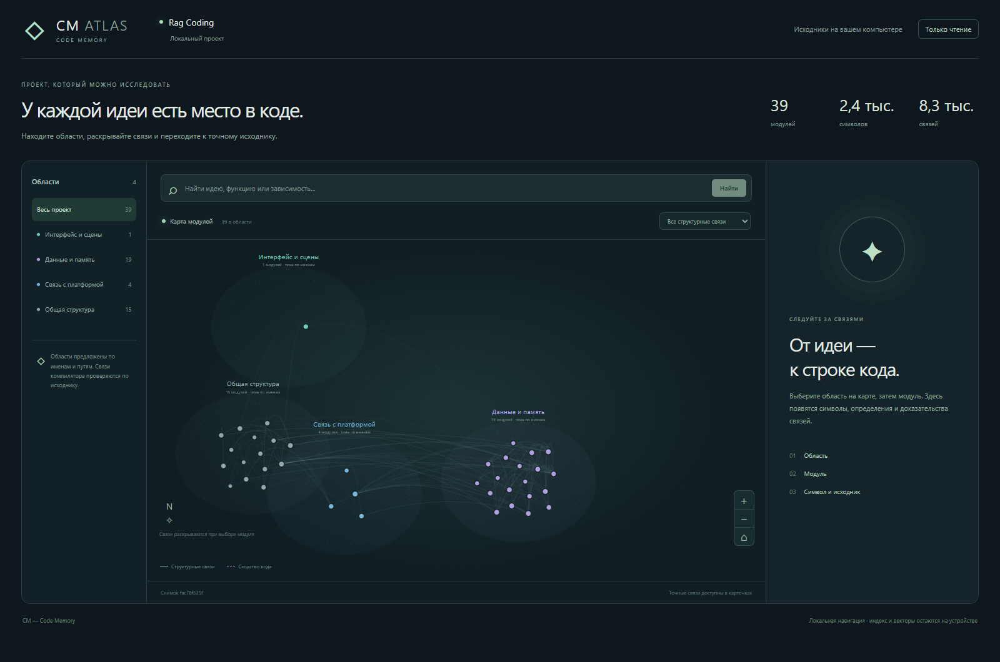

# Code Memory for DeepSeek Harness

**Give your coding agent the relevant source before its first step.** Code Memory (CM) is a local code index and context plugin for JavaScript and TypeScript projects. It combines symbol lookup, dependency graphs, and semantic search to reduce repeated source discovery.

**Unofficial community project.** Independently developed; not affiliated with or endorsed by DeepSeek.

**English** · [Русский](README.ru.md) · [Download v0.9.2](https://github.com/kobubu/Rag-Coding/releases/tag/v0.9.2) · [Windows installation](docs/INSTALL-WINDOWS.md)

## What it does

- Supplies compact source context before the first model call in DeepSeek Harness.
- Looks up named files and symbols directly; uses local MiniLM embeddings and LanceDB when discovery is needed.
- Expands relevant dependencies using the TypeScript compiler's symbol and call graph.
- Checks source versions and avoids repeating unchanged whole files already supplied to Harness.
- Exposes an MCP server for Codex and Claude Code and an optional `UserPromptSubmit` hook for automatic context.
- Includes CM Atlas, a local map of modules, symbols, and their relationships.

The index, embeddings, and graph stay on your computer. Selected code is still sent to your model provider when you use a cloud model. CM does not include model credits or a model-provider subscription.



Actual CM Atlas screenshot of this repository's public `src` directory: 39 modules, 2,409 symbols, and 8,321 relationships. The current Atlas interface is in Russian; the installation guide below is in English.

## Measured results, with limits

The published Harness pilot used GPT-6 Luna on **six task types in one repository**, Geo Dash. Three evaluation series each ran 36 sessions: no CM, the earlier CM, and the newer CM, with two repeats per task and arm.

| Newer CM versus no CM | Published result |
|---|---:|
| Total model tokens | 45–66% fewer across the three series |
| Estimated model price | 30–47% lower |
| Total Harness session time | 18–37% lower |
| Independently checked solutions, pooled across series | 36/36 with newer CM; 35/36 without CM |

These are **small, single-project pilot results**, not guaranteed savings. The ranges are observed series results, not confidence intervals. Costs are estimates; session time does not include first-time installation or indexing. All attempts, including failures, are retained. Earlier approaches and native-client experiments have different outcomes; do not transfer these percentages to every client or workload.

### Codex and Claude Code

In Codex and Claude Code, CM adds its context through a `UserPromptSubmit` hook served by a warm local daemon; the installer configures it. Fourteen tasks in the same repository — the six above plus eight new ones that CM was not tuned on — three repeats per task and arm, 84 sessions per client:

| CM versus no CM | Codex, GPT-6 Luna | Claude Code, Sonnet 5.5 |
|---|---:|---:|
| Independently checked solutions | 41/42 vs 40/42 | 42/42 vs 42/42 |
| Total model tokens | 58.0% fewer | 40.4% fewer |
| Estimated / reported price | 29.0% lower | 18.0% lower |
| Total session time | 35.9% lower | 35.1% lower |
| Median session | 7.3 s vs 12.2 s | 12.4 s vs 18.7 s |

In both clients the paired 95% bootstrap intervals for tokens and time exclude zero. This is still one project and small seeded fixes, not a guarantee for other workloads. The MCP server alone, without the hook, showed no savings.

[Method, raw results, and reproduction](docs/EFFICIENCY-AB.md) · [Codex and Claude Code experiments](docs/NATIVE-CLIENTS.md) · [What did not work](docs/HISTORY.md)

## Install into an existing Harness

Requires DeepSeek Harness **0.2.0-rc.2** and Node.js 24 or 22.19+ within 22.x:

```bash
dsh plugin --profile web add github:kobubu/Rag-Coding#v0.9.2
```

The tag contains the compiled plugin, CLI entry points, and Atlas. CM needs no installation build or Vite/React runtime modules. Then [prepare the project index and local model](docs/DEEPSEEK-PLUGIN.md#github-installation). A ready release tarball is also available:

```bash
dsh plugin --profile web add https://github.com/kobubu/Rag-Coding/releases/download/v0.9.2/dsh-plugin-code-memory-0.9.2.tgz
```

Git tags before 0.9.1 require their release tarball or an explicit source build. The new runtime works with scripts disabled; native dependencies follow the host package manager's policy.

If CM was installed with the Windows bootstrap, update it using the new ZIP and the same `-InstallRoot`. Harness 0.2.0-rc.2 can prefer a CM copy beside its own installation over a profile-installed copy; adding another Git dependency to that older installation does not replace its launcher or embedded copy. The bootstrap creates a new release directory and switches managed project launchers.

## Install on Windows

Download **CM-0.9.2-Windows.zip** and **SHA256SUMS.txt** from the [v0.9.2 release](https://github.com/kobubu/Rag-Coding/releases/tag/v0.9.2), verify the checksum, and extract the ZIP. From the extracted folder, run:

```powershell
powershell -NoProfile -ExecutionPolicy Bypass -File .\install_cm.ps1 -ProjectRoot 'C:\path\to\your-project' -Clients harness
```

The installer uses a compatible Node.js or downloads a private runtime, installs CM and Harness **0.2.0-rc.2**, downloads the embedding model, and prepares your index. Administrator rights and a source checkout are not required. Internet access is required for the initial dependencies and model downloads. Open the generated `start-harness.ps1` path printed by setup, then configure your model provider in Harness.

Use `-SourceScope src` to index a subdirectory. Use `-Clients harness,codex,claude` to add project MCP connections for all three clients; Codex and Claude Code must be installed separately. Their automatic-context hook is currently a **separate manual setup**, not an installer default.

[Install, launch, verify, and remove](docs/INSTALL-WINDOWS.md) · [Native-client hook setup](docs/NATIVE-CLIENTS.md)

## Build from source

Use Node.js **24 LTS**, or Node.js **22.19.0+ within the 22.x line**.

```bash
git clone https://github.com/kobubu/Rag-Coding.git
cd Rag-Coding
npm ci
npm run verify
npm run cm:index
npm run cm:vectors
npm run cm:search -- --query "how are embeddings reused between snapshots"
npm run plugin:smoke
```

`plugin:smoke` checks both legacy and compact tools, automatic context, filesystem observations, and unload through the real Harness runtime without a model call. In PowerShell, use `npm.cmd` for commands that forward flags. For restricted cloud builds, `ONNXRUNTIME_NODE_INSTALL=skip npm ci` skips the native runtime download; running local embeddings still requires a working ONNX runtime.

The Windows bootstrap is the packaged installation path. A macOS/Linux installer, automatic release updates, and a subscription service are not included.

For source changes, `npm run compile` rebuilds the runtime. Commit matching `dist/src/` and `dist/viewer/`; `npm run package:check` and CI reject missing/stale artifacts. The command is named `compile` because npm treats a script named `build` as a reason to rebuild Git dependencies.

## Documentation

The following engineering documents are currently in Russian; the README and Windows release guide are in English.

| Document | Contents |
|---|---|
| [How CM works](docs/HOW-IT-WORKS.md) | Routing, graph expansion, context budgets, and source freshness |
| [Harness integration](docs/DEEPSEEK-PLUGIN.md) | Bundle installation, configuration, and tools |
| [MCP setup](docs/MCP-SETUP.md) | Shared local retrieval for coding clients |
| [CM Atlas](docs/LOCAL-ATLAS.md) | Local project visualization |
| [Release notes](docs/releases/v0.9.2.md) | What is included in the public package |
| [Release procedure](docs/RELEASING.md) | Rebuilding the installer and checking artifacts |

CM is written in TypeScript/Node.js. Project code is indexed without being executed. Supported inputs are JavaScript/TypeScript source files; current corpus limits are 500 files and 8 MiB of source. See [contribution rules](CONTRIBUTING.md).

## Try it on another repository

[Show Your Plugins discussion](https://github.com/deepseek-ai/deepseek-harness/discussions/10196) · [Community catalog submission](https://github.com/awesome-dsh-plugin/awesome-dsh-plugin/pull/7989)

Independent A/B results are welcome: use the same task, model, reasoning settings, checks, and starting commit with CM on and off. Include indexing/setup time separately, all failed attempts, total tokens, elapsed time, and whether the patch actually passes independent checks. Report regressions as well as wins in [Issues](https://github.com/kobubu/Rag-Coding/issues).
