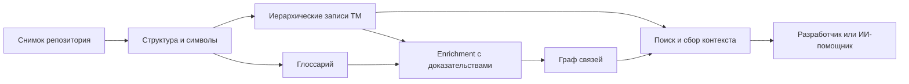

# RAG Coding

База знаний для разработки: **все сущности — в глоссарии, исходный код — в иерархической ТМ, зависимости — в графе**. Поиск собирает контекст нужной детализации и привязывает его к точной версии проекта.

Состояние на 13 октября 2026 года: подготовлены концепт, технические спецификации, план реализации и диагностический пример дробления. Сервис индексации, поисковый API и интерфейс ещё предстоит разработать. Диагностическая проверка структуры не является измерением качества RAG.

Основной язык продукта — **TypeScript**, среда выполнения — **Node.js 24 LTS**. API планируется на Fastify, интерфейс — на React + TypeScript. Первый индексируемый корпус — TypeScript; Python и C# подключаются отдельными языковыми адаптерами. Для ledger и графа выбран PostgreSQL, для векторного поиска — pgvector; хранилища ещё не запущены. Подробнее — [архитектура](docs/ARCHITECTURE.md).

## С чего читать

1. [Концепт продукта](CONCEPT.md) — назначение глоссария, ТМ и графа, пример из FlashMT.
2. [Подробный план](plans/ROADMAP.md) — этапы, зависимости и критерии перехода.
3. [Первая итерация](plans/FIRST-ITERATION.md) — конкретные первые изменения и проверки.
4. [Полный backlog](plans/BACKLOG.md) — задачи и ожидаемые результаты; [JSON](plans/backlog.json) является источником этого представления.
5. [Навигация по документации](docs/README.md) — архитектура, контракты, алгоритмы и эксплуатация.

## Основная схема



Запись ТМ может быть функцией или небольшим блоком. Для понимания вложенного блока поиск получает определения внешних переменных, условия и нужные родительские конструкции. Исходный текст, описания модели и подтверждённые инженерные решения имеют разное происхождение.

## Что можно проверить сейчас

Рекомендуется Node.js 24 LTS; документационные инструменты также поддерживают Node.js 22 от 22.17.0. Зависимости закреплены в `package-lock.json`. Python для основных проверок не требуется.

```bash
npm ci
npm run verify
```

Команды одинаковы на Windows и Linux. `verify` собирает TS-инструменты, проверяет документы, backlog и JSON Schema, запускает регрессии и диагностический CLI. Собственная [TS-fixture](fixtures/batching.ts) проверяется через TypeScript Compiler API: исходные байты, четыре группы тела и три привязки вложенной функции. Код fixture не исполняется. Результаты пишутся в игнорируемую папку `.artifacts/`; собранный JavaScript — в `dist/`.

Отдельные команды после `npm run build`: `npm run check`, `npm test`, `npm run probe -- --fixture --output .artifacts/probe.json`. Обновление представления backlog: `npm run backlog`; проверка актуальности: `npm run backlog -- --check`.

В PowerShell для команд с передачей флагов использовать `npm.cmd`, например `npm.cmd run backlog -- --check` и `npm.cmd run probe -- --fixture --output .artifacts/probe.json`. Это сохраняет аргументы подкоманды при использовании Windows npm shim. Основная команда `npm run verify` флагов не требует; CI выполняет команды в Bash на обеих ОС.

Для повторения исследования Python-исходников FlashMT сохранён необязательный отдельный инструмент. Только ему нужны Python 3.11 и локальный checkout:

```powershell
py -3.11 scripts/probe_flashmt_chunking.py --source-root 'D:\models\Portal Services'
```

Он требует указанный checkout и только читает три файла. [Исследование FlashMT](research/FLASHMT-ENRICHMENT.md) описывает точную исходную версию, ограничения и [сохранённые метаданные проверки](research/evidence/flashmt-chunking-probe-2026-10-13.json). Исходный код FlashMT в этот репозиторий не включён.

[Правила изменения материалов](CONTRIBUTING.md) и [источники технических решений](docs/SOURCES.md).
