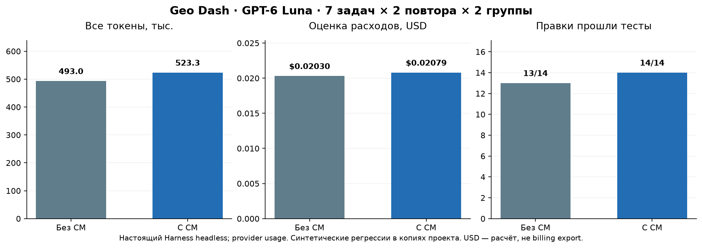

# Живой Harness A/B: результат Geo Dash pilot

13 октября 2026 года. Экономия в текущем CM prototype не подтвердилась: +6,2% суммарных токенов и +2,4% расчётной цены. Все 14 CM-правок прошли независимые проверки; без CM прошли 13 из 14. Это небольшой pilot на одном проекте; общий выигрыш качества из него не следует.

## Протокол и источники

Модель `gpt-6-luna`, Responses API, reasoning low; установленный DeepSeek Harness 0.2.0-rc.2 на Node.js 24.21.0. Upstream source скачан на `d743267388641bc76f17c45ce8b4c231aed1d32c`; запускался установленный RC CLI, а не собранный alpha checkout. Один corpus: 224 Git-tracked JS-файла, 3 559 518 bytes, исходная revision `47ed7fef0d3961333ab61ccf131e28249742d68e`. Source hashes всех 224 файлов после серии совпали; чужие WIP сохранены.

Семь seeded regressions × два повтора × два варианта = 28 sessions. Порядок AB/BA чередуется; workspace и history свежие. Обе группы получили одинаковое правило навигации: CM при наличии, иначе обычный поиск. Oracle закрыт от модели; исходные behavioral checks проходят, seeded copies до правки падают. Ещё одна development-задача сохранена отдельно и исключена до основного запуска. Подробности в [протоколе](HARNESS-AB.md); полный безопасный итог — [JSON](../evaluation/geo-dash-pilot/results.json).

## Вся основная серия

| Метрика | A: без CM | B: с CM |
|---|---:|---:|
| Sessions / успешные правки | 14 / 13 | 14 / 14 |
| Модельные вызовы | 84 | 90 |
| CM tool calls | 0 | 42 |
| Суммарные input + output tokens | 492 968 | 523 299 |
| Input tokens | 487 439 | 517 015 |
| Output tokens | 5 529 | 6 284 |
| Uncached input | 252 | 270 |
| Cache read | 377 295 | 408 465 |
| Cache write | 109 892 | 108 280 |
| Цена по reported usage, USD | 0,02029915 | 0,02078865 |
| Среднее время session, сек. | 17,41 | 26,32 |
| Runtime errors / missing usage | 0 / 0 | 0 / 0 |

Цена рассчитана по ставкам на дату проверки: за 1M tokens input $0,10, cache read $0,01, cache write $0,125, output $0,50. Это оценка, не подтверждённое списание. Input/cache категории складываются один раз; повторная отправка истории входит в итог. [Официальная модель и цены](https://developers.openai.com/api/docs/models/gpt-6-luna).

| Тип задачи, два повтора | A tokens | B tokens | Изменение B к A | Успех A / B |
|---|---:|---:|---:|---:|
| Проверка календарной даты | 68 681 | 60 429 | −12,0% | 2 / 2 |
| Дневная квота и перевод часов назад | 56 223 | 95 053 | +69,1% | 2 / 2 |
| Исключительная конечная граница hold | 84 018 | 45 329 | −46,0% | 2 / 2 |
| Фильтр глубины препятствия | 54 871 | 60 940 | +11,1% | 2 / 2 |
| Слияние grants из старого save | 140 674 | 143 575 | +2,1% | 2 / 2 |
| Последовательность economy queue | 40 088 | 51 947 | +29,6% | 1 / 2 |
| Отмена pointer на карте | 48 413 | 66 026 | +36,4% | 2 / 2 |

В неуспешной A session агент обнаружил нарушение очереди и завершил ответ без правки. Harness exit code был 0; независимая проверка по-прежнему обнаружила одновременное выполнение задач. Failure входит во все итоговые метрики. Все B sessions действительно использовали CM. Отдельный `cm_graph_expand` не вызывался: результат не изолирует вклад графового обхода.

## Почему CM оказался дороже

1. **В этой версии нет embeddings и vector search.** Проверены lexical/structural CM retrieval и Harness adapter; вывод не является отрицательным тестом полноценного vector RAG.
2. **Дополнительные turns перекрыли уменьшение input на один вызов.** B сделал на шесть model calls больше. Средний input на вызов был примерно на 1% меньше, но schemas, metadata и накопленная history отправлялись снова.
3. **Поиск и чтение не были сведены в одну операцию.** B сделал 42 CM calls и 14 обычных read; после discovery/context оставались filesystem observations перед правкой. На квоте широкие queries раскрыли больше кандидатов.
4. **Output тоже вырос.** B сгенерировал 6 284 tokens против 5 529. Отдельная цена output и доля cache объясняют, почему рост цены отличается от роста total tokens.

Средние tokens на успешную правку ниже у B: 37 378,5 против 37 920,6. Это другой показатель, включающий failure A в общий расход; он не превращает увеличение общего бюджета в экономию всей серии.

## Масштаб и ограничения

Индекс содержит 16 465 code units, 29 186 symbols, 130 775 relations; derived JSON занимает 69 989 756 bytes. Оптимизация индексатора уменьшила измеренное время с 249,90 до 10,23 секунд; snapshot, source units, symbols, relations и diagnostics семантически совпадают. Это отдельное local performance измерение на том же corpus, не среднее по множеству устройств.

Основная серия мала, задачи искусственно вносят regression, два повтора одного task type зависимы. Exploratory bootstrap по семи типам задач даёт диапазон экономии токенов от −34,2% до +16,7%; он допускает и проигрыш, и выигрыш. Нет production bug claim, независимого теста vector search, graph ablation или UI QA. Текущий CLI reader предназначен для `game/**/*.js`; другие проекты требуют собственного corpus adapter/oracle.

## Следующий эксперимент

Сначала local embeddings/vector projection и один `retrieve_context(query, budget, scope)`: exact/FTS/vector merge, rerank, минимальные dependencies и dedupe внутри core. Модель получает компактный source context вместо нескольких каталогов IDs. Затем новый holdout A/B с полной стоимостью retrieval/enrichment и cold/warm indexing. MCP и world map используют тот же core. Концепция и план: [локальный продукт](LOCAL-PRODUCT.md), [RC-047…RC-052](../plans/BACKLOG.md).
