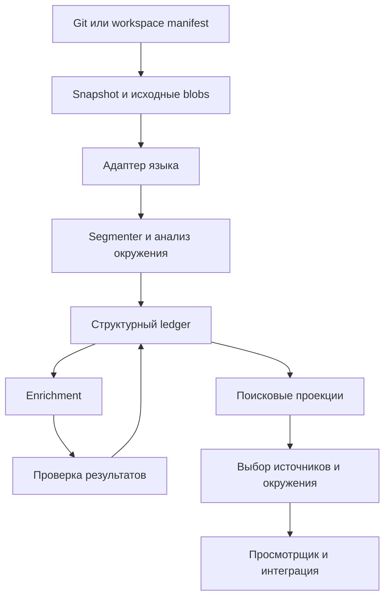

# Архитектура

## Компоненты и ответственности

| Компонент | Ответственность | Что выдаёт |
|---|---|---|
| Repository reader | Читает Git-снимок или manifest рабочего дерева; не исполняет проект | Snapshot и FileVersion |
| Language adapter | Разбирает синтаксис и доступную семантику конкретного языка | Контейнеры, символы, употребления, диагностику |
| Segmenter | Выделяет иерархию записей и первичную разбивку исходника | CodeUnit и связи принадлежности |
| Context analyzer | Устанавливает нужные внешние привязки и конструкции | ContextRequirement и структурные зависимости |
| Enrichment worker | Описывает роли и предлагает смысловые связи по ограниченному контексту | Аннотации и предложения с доказательствами |
| Admission layer | Проверяет версии, идентификаторы, типы связей и доказательства | Принятые, кандидатные или отклонённые результаты |
| Source ledger | Хранит исходные версии, результаты и историю подтверждений | Восстанавливаемые факты и состояния |
| Search projections | Точный, текстовый и векторный поиск; таблицы смежности | Кандидаты выдачи |
| Context service | Выбирает детализацию и восстанавливает окружение | ContextPackage |
| Viewer / integration | Навигация человека, редактора и помощника | Карточки, исходники, граф и ответы |



## Предлагаемая техническая основа

TypeScript в strict mode и Node.js 24 LTS — основа управляющего сервиса, CLI, API и фоновых workers. Формат модулей — ESM. Первый индексируемый корпус — TypeScript; TypeScript Compiler API предоставляет синтаксис и доступную семантику. Язык сервиса и язык индексируемого проекта — разные настройки: Python, C# и другие языки подключаются адаптерами с общим JSON-контрактом.

Агентская оболочка — DeepSeek Harness; наш внешний plugin регистрирует четыре read-only CM tools. Рабочий prototype находится в `src/code-memory/` и `src/harness/`. CLI строит bounded JSON index отдельным процессом, а plugin читает готовые snapshots, проверяет версии и вызывает query core. ToolRuntime интеграция закреплена на 0.2.0-rc.2, Cordis — 4.0.4. Установка и пределы — в [инструкции](DEEPSEEK-PLUGIN.md).

PostgreSQL — ledger, состояния заданий, точные и текстовые индексы; pgvector — дополнительная векторная проекция. Исходные байты сохраняются в локальном content-addressed blob store, заменяемом через интерфейс. Стартовая очередь — таблица заданий в PostgreSQL, чтобы не добавлять брокер до измерения необходимости.

Граф начинается с типизированных таблиц связей и ограниченных обходов. Выделение графовой БД зависит от профилирования, а не размера рисунка. Векторы и граф — производные представления, их готовность отделена от сохранения исходника. Основания выбора перечислены в [решениях](DECISIONS.md).

Первый API на Fastify и CLI используют одинаковые доменные операции чтения и поиска. Viewer планируется на React + TypeScript. Внешние контракты остаются JSON Schema draft 2020-12; runtime-проверка выполняется Ajv2020. ORM/SQL-доступ и модель embeddings выбираются на своих технических spikes. Fastify, React и доступ к БД пока не реализованы и не установлены как зависимости диагностики.

CPU-intensive parsing, segmentation и анализ связей выполняются в отдельных CLI/worker процессах, отдельно от runtime обработчиков tools/API. Jobs будущего сервиса имеют lease/fingerprint правила независимо от процесса. Node.js не является основанием обещать ускорение retrieval без измерений. Поддерживаются Node.js 22 от 22.19.0 и Node.js 24; целевая версия продукта — 24 LTS.

## Адаптеры языков

| Язык | Начальный инструмент | Дополнительная семантика | Граница возможностей |
|---|---|---|---|
| TypeScript / JavaScript / TSX — первый | TypeScript Compiler API | Program и TypeChecker; SCIP как формат обмена при необходимости | Нужны корректные tsconfig, project references и зависимости; JSX и JS capabilities публикуются отдельно |
| Python — дополнительный | Tree-sitter для синтаксиса или отдельный `ast`/`symtable` worker | Проектный индексатор / доступный SCIP backend после spike | Динамические атрибуты и импорты могут оставаться неразрешёнными |
| C# | Roslyn syntax и semantic model | Compilation с проектными references | Partial-типы и перегрузки связываются на уровне символа |
| Другие языки | Tree-sitter для синтаксиса | Адаптер компилятора или индексатор | Синтаксическая навигация не равна разрешению вызовов |

Это план адаптеров. Основной диагностический скрипт на TS проверяет ограниченный TS-пример через Program/TypeChecker, включая LF, CRLF, UTF-8 BOM и UTF-16→byte mapping. Необязательный Python-скрипт сохранён для повторения исследования FlashMT. Ни один probe не является готовым многоязычным индексатором. Первичные документы — в [SOURCES](SOURCES.md).

Общий результат адаптера включает capabilities: синтаксис, области, определения, употребления, типы, проектное разрешение, поток данных. Каждый capability имеет состояние и диагностику. Клиент не приписывает неподдерживаемую способность по наличию файла индекса.

## Границы компонентов

Language adapter возвращает нейтральную модель и исходные координаты инструмента. Mapping layer переводит их в диапазоны исходного blob. Segmenter не запускает модель и не изменяет исходник. Enrichment получает конкретные версии известных символов; admission не создаёт неизвестные определения, чтобы принять предложение.

Контекстный сервис сначала фиксирует snapshot и доступ. Он может использовать только записи и проекции этой области. Неполные проекции позволяют ограниченную выдачу с диагностиками; смешивание старого графа с новым кодом запрещено.

## Предлагаемая структура реализации

```text
src/
  domain/          # версии, записи, доказательства, контракты
  repositories/    # Git/workspace reader и blobs
  adapters/        # язык и преобразование координат
  segmentation/    # иерархия, первичная разбивка, бюджеты
  analysis/        # символы и требования окружения
  enrichment/     # предложения, проверка, jobs
  storage/        # ledger и поисковые проекции
  retrieval/      # кандидаты, ранжирование, ContextPackage
  interfaces/     # TypeScript CLI/Fastify API, позднее editor integration
  workers/        # процессы / worker threads для тяжёлого анализа
viewer/           # будущий React + TypeScript интерфейс
```

Эта структура описывает развитие core; большинство перечисленных подсистем ещё не реализовано. Уже созданы `src/code-memory/` (local index/store/query/CLI), `src/harness/` (plugin), `harness/bundle.yml` (distribution entry). TS-средства находятся в `scripts/`, регрессии — в `tests/`; `tsconfig.json` собирает их в `dist/`. Локальный JSON backend отдельно версионирован и не объявляется PostgreSQL ledger или полноценным API v0.1.
