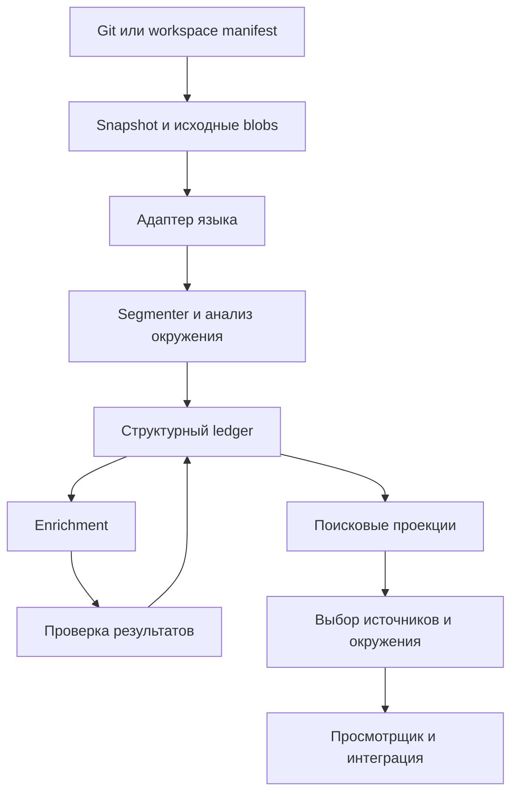

# Архитектура

## Компоненты и ответственности

| Компонент | Ответственность | Что выдаёт |
|---|---|---|
| Repository reader | Читает Git-снимок или manifest рабочего дерева; не исполняет проект | Snapshot и FileVersion |
| Language adapter | Разбирает синтаксис и доступную семантику конкретного языка | Контейнеры, символы, употребления, диагностику |
| Segmenter | Выделяет иерархию записей и первичную разбивку исходника | CodeUnit и связи принадлежности |
| Context analyzer | Устанавливает нужные внешние привязки и конструкции | ContextRequirement и структурные зависимости |
| Enrichment worker | Описывает роли и предлагает смысловые связи по ограниченному контексту | Аннотации и предложения с доказательствами |
| Admission layer | Проверяет версии, идентификаторы, типы связей и доказательства | Принятые, кандидатные или отклонённые результаты |
| Source ledger | Хранит исходные версии, результаты и историю подтверждений | Восстанавливаемые факты и состояния |
| Search projections | Точный, текстовый и векторный поиск; таблицы смежности | Кандидаты выдачи |
| Context service | Выбирает детализацию и восстанавливает окружение | ContextPackage |
| Viewer / integration | Навигация человека, редактора и помощника | Карточки, исходники, граф и ответы |



## Предлагаемая техническая основа

Python 3.11 — управляющий сервис и первый адаптер. PostgreSQL — ledger, состояния заданий, точные и текстовые индексы; pgvector — дополнительная векторная проекция. Исходные байты сохраняются в локальном content-addressed blob store, заменяемом через интерфейс. Стартовая очередь — таблица заданий в PostgreSQL, чтобы не добавлять брокер до измерения необходимости.

Граф начинается с типизированных таблиц связей и ограниченных обходов. Выделение графовой БД зависит от профилирования, а не размера рисунка. Векторы и граф — производные представления, их готовность отделена от сохранения исходника. Основания выбора перечислены в [решениях](DECISIONS.md).

Первый API и CLI используют одинаковые операции чтения и поиска. ORM, HTTP-фреймворк и модель embeddings фиксируются на техническом spike первой итерации; это не препятствует разработке доменных контрактов.

## Адаптеры языков

| Язык | Начальный инструмент | Дополнительная семантика | Граница возможностей |
|---|---|---|---|
| Python | `ast`, `symtable`, сохранение исходных bytes | Проектный индексатор / доступный SCIP backend после spike | Динамические атрибуты и импорты могут оставаться неразрешёнными |
| TypeScript / TSX | TypeScript Compiler API | Program, TypeChecker или совместимый SCIP index | Нужны корректные tsconfig и зависимости |
| C# | Roslyn syntax и semantic model | Compilation с проектными references | Partial-типы и перегрузки связываются на уровне символа |
| Другие языки | Tree-sitter для синтаксиса | Адаптер компилятора или индексатор | Синтаксическая навигация не равна разрешению вызовов |

Это план адаптеров. Текущий диагностический скрипт проверяет только ограниченный Python-пример. Первичные документы — в [SOURCES](SOURCES.md).

Общий результат адаптера включает capabilities: синтаксис, области, определения, употребления, типы, проектное разрешение, поток данных. Каждый capability имеет состояние и диагностику. Клиент не приписывает неподдерживаемую способность по наличию файла индекса.

## Границы компонентов

Language adapter возвращает нейтральную модель и исходные координаты инструмента. Mapping layer переводит их в диапазоны исходного blob. Segmenter не запускает модель и не изменяет исходник. Enrichment получает конкретные версии известных символов; admission не создаёт неизвестные определения, чтобы принять предложение.

Контекстный сервис сначала фиксирует snapshot и доступ. Он может использовать только записи и проекции этой области. Неполные проекции позволяют ограниченную выдачу с диагностиками; смешивание старого графа с новым кодом запрещено.

## Предлагаемая структура реализации

```text
src/rag_coding/
  domain/          # версии, записи, доказательства, контракты
  repositories/    # Git/workspace reader и blobs
  adapters/        # язык и преобразование координат
  segmentation/    # иерархия, первичная разбивка, бюджеты
  analysis/        # символы и требования окружения
  enrichment/     # предложения, проверка, jobs
  storage/        # ledger и поисковые проекции
  retrieval/      # кандидаты, ранжирование, ContextPackage
  interfaces/     # CLI/API, позднее editor integration
```

Эта структура описывает будущие каталоги; сейчас они не созданы. Рабочие документационные средства находятся в `scripts/`.
