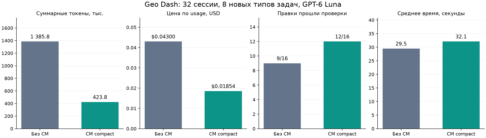

# Локальный vector RAG и compact CM: второй A/B

13 октября 2026 года. **−69,4% суммарных токенов, −56,9% расчётной цены; 12/16 правильных правок против 9/16 без CM**. Цель подтверждена в этом pilot. Средняя session с CM заняла 32,11 сек. против 29,48; ускорение по времени не достигнуто. Четыре CM failures сохранены. Это один проект и небольшой набор seeded regressions.

## Реализация

Локальная `Xenova/all-MiniLM-L6-v2`, revision `751bff37182d3f1213fa05d7196b954e230abad9`, q8, CPU, mean pooling/normalization даёт 384-dimensional learned embeddings. LanceDB 0.40.0 хранит 7 503 retrievable units на диске. Используется flat cosine search; ANN index отдельно не создаётся. Primary CM/graph остаётся JSON. SQLite ledger/FTS, MCP и map UI запланированы. [Модель](https://huggingface.co/Xenova/all-MiniLM-L6-v2), [LanceDB](https://github.com/lancedb/lancedb/blob/main/README.md).

Hybrid retrieval соединяет explicit identifiers, lexical IDF и dense candidates. Выбирает ограниченное число units, добавляет required declarations, дедуплицирует ranges и выдаёт source spans в пределах 6 000 UTF-8 bytes. Полные lexical parents автоматически не прикладываются. Completeness partial; budget измеряется в bytes.

В `compact` один `cm_retrieve_context` заменяет четыре discovery tools. Auto context выдаёт source до первого model call через logged сообщение producer `code-memory`. Плагин читает файлы штатным `ctx.fs`, сравнивает hashes/версии до и после чтения, передаёт `fs/observed`. Обычный edit сохраняет CAS guard и часто обходится без повторного read. [Подключение](DEEPSEEK-PLUGIN.md).

## Протокол

Восемь новых типов задач выбраны до candidate model runs, по два повтора A/B — 32 sessions. Корпус: 224 tracked JS-файла, 3 559 518 bytes. `gpt-6-luna`, Responses API, reasoning low; native Harness 0.2.0-rc.2, Node 24.21.0. Одинаковые prompts, source bytes, native tools, limits и закрытый independent oracle; свежие profiles/workspaces/history, порядок AB/BA.

Калибровка использовала два типа задач первого pilot. Три integration attempts были недействительными: не была объявлена зависимость `systemPrompt`, а Harness продолжал с warning. Они сохранены отдельно. После исправления зависимости и prompt admission два B calibration runs дали правильные правки за два calls каждый. Затем implementation зафиксирован для main; hashes после серии совпали.

Перед первым платным вызовом meter требует `cm_retrieve_context` в schemas и CM context в model-visible messages. Это выполнено во всех 16 B sessions; во всех A CM отсутствует. Все 228 model calls имеют settled usage/finish event. Baseline oracle проходит на исходнике и падает на каждой seeded regression.

## Полный результат

| Метрика | A: без CM | B: compact CM |
|---|---:|---:|
| Sessions / правильные правки | 16 / 9 | 16 / 12 |
| Model calls | 160 | 68 |
| Total input + output tokens | 1 385 771 | 423 790 |
| Input tokens | 1 374 751 | 417 340 |
| Output tokens | 11 020 | 6 450 |
| Uncached input | 480 | 204 |
| Cache read | 1 168 199 | 320 432 |
| Cache write | 206 072 | 96 704 |
| Цена по usage, USD | 0,04299899 | 0,01853772 |
| Среднее время, сек. | 29,48 | 32,11 |
| Остановки по call limit | 2 | 0 |
| Missing usage | 0 | 0 |

Те же ставки Luna, что [в первом pilot](AB-RESULTS.md), с раздельными cache categories. Это оценка, не billing export. Local embedding/enrichment provider calls отсутствуют. CPU indexing, development и время разработчика не входят в per-task API price. [Официальные цены](https://developers.openai.com/api/docs/models/gpt-6-luna).

Два A runs остановились перед 13-м call: 12 разрешённых вызовов завершились с usage, guard отклонил следующий до provider. У одной такой session правка прошла behavioral checks. Runtime и качество патча различаются; все failures и их расход включены. Полнота учёта проверяется по settled usage.

| Тип задачи, два повтора | A tokens | B tokens | Экономия B | Успех A / B |
|---|---:|---:|---:|---:|
| Интерполяция/endpoints | 132 970 | 80 589 | 39,4% | 1 / 2 |
| Вертикальное разделение rectangles | 189 175 | 113 083 | 40,2% | 0 / 1 |
| Начало фазы движения | 248 341 | 126 524 | 49,1% | 0 / 0 |
| Валидация record bonus | 75 522 | 12 846 | 83,0% | 2 / 2 |
| Валидация purchase receipt | 222 177 | 17 640 | 92,1% | 0 / 2 |
| Повторное получение coin | 108 512 | 44 265 | 59,2% | 2 / 1 |
| Покупка при точном balance | 303 797 | 15 601 | 94,9% | 2 / 2 |
| Повторный login grant | 105 277 | 13 242 | 87,4% | 2 / 2 |

## Ограничения и доказательства

Экономию дала связка hybrid retrieval, compact schemas/context, auto admission и filesystem observations. Отдельный вклад dense vectors не изолирован. Задачи отличаются от первого pilot; это два самостоятельных A/B набора. Повторы зависимы, несколько задач используют одни модули. Exploratory task bootstrap диапазон экономии 50,9–86,1% описывает этот набор.

Есть ошибки выбора vendor/параллельных модулей; все B failures публикуются. Следующие задачи — provenance/scope и latency. Возможны omissions; full dataflow и automatic refresh после edits отсутствуют. Один A glob result показал `.code-memory`; trace audit не нашёл ни одного read CM artifacts моделью.

Первый embedding build: 7 342 unique texts, 7 503 rows, 259,96 сек. Cache позволил вычислить только 0–2 новых embeddings на prepared snapshot; перепись tables заняла 7–20 сек. Model/tokenizer cache около 24 MB. Это local measurements данного устройства.

Reusable runner: `npm.cmd run harness:ab -- ... --cm-mode compact --model-cache /absolute/cache`. Передать свои cases/oracle либо local private inputs. [HARNESS-AB](HARNESS-AB.md); [полный безопасный JSON](../evaluation/geo-hybrid-pilot/results.json) содержит 32 results, hashes, activation и indexing. Private prompts/code/oracle/raw traces остаются в `.artifacts/`. Все 224 original hashes совпали; credential kernel очищен, Harness processes завершены.
