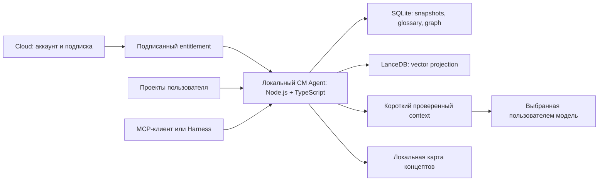

# CM на компьютере пользователя: MCP, подписка и карта концептов

Это концепция следующей поставки. Сейчас реализованы локальный TS/JS CM core и Harness adapter; vector database, MCP server, карта концептов, accounts и billing ещё не реализованы. [A/B pilot](HARNESS-AB.md) проверил lexical/structural prototype, поэтому не является тестом полноценного vector RAG.

## Пользовательский путь

Пользователь регистрируется, оформляет подписку, устанавливает локальный CM Agent, выбирает проекты и подключает его к MCP-клиенту. Индексатор, source snapshots, векторы, глоссарий и граф находятся на его компьютере. Локальная панель показывает карту проекта и результаты поиска. Cloud account выдаёт entitlement и обновления; исходный код не требуется переносить в облачную базу.

MCP может подключать локальный процесс через stdio либо сервер через Streamable HTTP. Для desktop-клиента предпочтителен stdio: клиент запускает CM Agent и вызывает его инструменты. Удалённый клиент не получает доступ к локальным файлам только от наличия облачного аккаунта: для него нужен явно настроенный bridge или remote endpoint. [Официальные транспорты MCP](https://modelcontextprotocol.io/specification/2025-11-25/basic/transports), [локальное подключение SDK](https://ts.sdk.modelcontextprotocol.io/v2/clients/connect).

Локальный index и inference embeddings могут работать без сети после первоначальной установки моделей. Если генерация выполняется облачной LLM, выбранные source snippets всё равно передаются этому провайдеру; локальность индекса сама по себе не делает генерацию локальной.

## Хранение и границы

Предлагаемый desktop backend: SQLite для transactional ledger, symbols, source manifests, FTS и graph edge tables; LanceDB для производных embeddings. Небольшие bounded graph traversals выполняются локально по tables. Отдельная Neo4j instance не требуется для первого клиента. PostgreSQL/pgvector сохраняется вариантом shared/team server, а не обязательной установкой на каждом ноутбуке.

LanceDB поддерживает локальную поставку, Node.js/TypeScript, vector и full-text поиск. Это кандидат для spike, а не dependency нынешнего plugin. Проверить native packaging, CPU/RAM, installer и updates на Windows/Linux/macOS до фиксации клиента. [Официальный LanceDB README](https://github.com/lancedb/lancedb/blob/main/README.md), [TypeScript API](https://lancedb.github.io/lancedb/js/globals/).

Source blobs и version IDs остаются первичными. Embeddings имеют model/version/config fingerprint и перестраиваются по изменившимся source hashes. Local model weights и indexes находятся в user data directory, исключены из обычного Git. Different projects не смешивают scopes; смена branch, rename, add/delete и unsaved overlay требуют корректного refresh.

## Как уменьшать расход модели

Одна операция `retrieve_context(query, budget, scope)` должна внутри выполнить exact/FTS + vector retrieval, merge/rerank, раскрытие минимальных dependencies и dedupe. Модели возвращается небольшой context с source references, omissions и версией. Следующие детали раскрываются по запросу. Это сокращает лишние model turns и повторную отправку каталогов ID.

Vector search отбирает candidates, но не гарантирует минимальный или правильный context. Для exact identifiers сохраняется точный канал. Graph expansion имеет бюджет и останавливается после необходимых declarations/guards. Полные parents не прикладываются автоматически к каждому nested block. Reranker или enrichment, использующие LLM, учитываются в общей цене, включая вызовы вне coding session.

Pilot показал необходимость именно этого интерфейса: B сделал 90 model calls против 84, добавил 42 CM calls и всё ещё использовал 14 обычных read. Нынешний prototype не имеет embeddings; он не подтвердил экономию всей задачи. Сначала измерить новый retrieve-context path, затем рекламировать подтверждённый результат, а не наличие vector database.

## World map проекта

Первый экран показывает области продукта: например, «карта», «управление», «реклама», «сохранение», «экономика». Область раскрывается в concepts, затем в functions/classes, затем в точные source spans и glossary symbols. Поиск и выбор узла подсвечивают используемые источники и обязательные зависимости.

Карта объединяет три отдельные смысловые категории: structural compiler facts, semantic similarity и inferred domain concepts. Тип, evidence и status связи видны по клику. Близкие embedding points не объявляются вызовом функции; модельная догадка не получает статус факта языка. Метки концептов могут быть предложены enrichment и подтверждены владельцем проекта.

Навигация: zoom по clusters, фильтр типов связей, поиск термина, путь зависимости, overlay «что затронет изменение», цвет актуальности snapshot и отдельное отображение unresolved edges. Viewer читает тот же CM core, что MCP и Harness; ручной рисунок не заменяет версионный граф. Подход сохраняет идею навигационного world map из FlashMT, адаптируя типы сущностей к коду.

## Подписка $10 в месяц

Предлагаемый тариф продаёт локальное приложение, MCP adapter, map UI, обновления индексатора и language adapters. Работа CPU и disk остаётся на машине пользователя. Cloud costs относятся к accounts, entitlement, delivery и поддержке, а не к хранению всех исходников и выполнению всех запросов.

LLM usage желательно вынести в собственный provider key пользователя либо явно ограниченные credits. Безлимитная cloud generation не следует автоматически из цены подписки. $10 — продуктовая гипотеза; её маржинальность нужно проверить по поддержке, активным пользователям и выбранным included services, а не по одному дешёвому benchmark.

Login выдаёт подписанный local entitlement с сроком действия и согласованным offline grace period. MCP читает entitlement локально; онлайн-проверка не нужна для каждого source lookup. Отмена подписки не должна удалять пользовательские indexes/source или мешать export. Лицензия, auth и права доступа к repository решают разные задачи.

## Следующие проверяемые этапы

1. Local vector/embedding spike: работа без внешнего embedding API, инкрементальный rebuild, точная версия projection и измерение resources.
2. Один bounded retrieve-context call с hybrid retrieval и компактным output; A/B на новых задачах, с полной стоимостью enrichment/retrieval.
3. MCP stdio adapter поверх того же core; реальный клиент проверяет cancellation, snapshots, permissions и output budgets.
4. Локальный viewer: из concept/graph node в реальные source spans; stale/unresolved состояния видны пользователю.
5. Installer и update path: совместимость native dependencies и сохранность local data.
6. Cloud account/entitlement и только затем billing experiment. Hosted service и приём платежей этим документом не запускаются.

Эти этапы развивают существующий plugin; полный PostgreSQL team backend, billing и production release остаются самостоятельными задачами.
