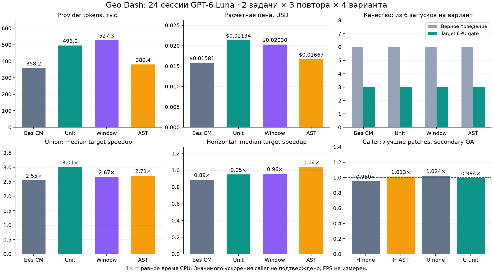

# CM: качество оптимизации и три варианта дробления

13 октября 2026 года завершены 24 живые сессии GPT-6 Luna в DeepSeek Harness на исправных исходниках Geo Dash: две задачи, три повтора, четыре варианта. В этой серии **CM не дал экономии токенов или цены и не увеличил число полезных оптимизаций целевой функции**. Дополнительная проверка вызывающего кода также не подтвердила существенного ускорения игры. Результаты предыдущего [pilot с исправлениями](HYBRID-RESULTS.md) относятся к другим задачам.

## Итог по всем запускам

| Вариант | Токены | Изменение к none | Цена по usage, USD | Изменение цены | Поведение | CPU gate целевой функции | Model calls |
|---|---:|---:|---:|---:|---:|---:|---:|
| Обычный Harness (`none`) | 358 234 | — | 0,015811555 | — | 6/6 | 3/6 | 50 |
| Целые units (`unit`) | 496 017 | +38,5% | 0,021335555 | +34,9% | 6/6 | 3/6 | 68 |
| Окна (`window`) | 527 321 | +47,2% | 0,020298525 | +28,4% | 6/6 | 3/6 | 70 |
| AST (`ast`) | 380 421 | +6,2% | 0,016673900 | +5,5% | 6/6 | 3/6 | 59 |

Все 247 model calls имеют завершённый provider usage; maximum request input — 13 713 tokens. Один `window` run исчерпал лимит 20 calls, сохранил корректную правку и остался в результате. Итоговая расчётная стоимость всей серии — **$0,074119535**. Ставки input/cache/output взяты из [официальной документации GPT-6 Luna](https://developers.openai.com/api/docs/models/gpt-6-luna); это usage estimate, не выписка биллинга. Локальные embeddings и разработка в эту сумму не входят.

Среднее время model session: none 38,17 сек., unit 81,23, window 78,93, AST 77,49. Отдельная подготовка projections: unit 280,72 сек., window 195,68, AST 156,62; shared embedding cache делает эти времена зависимыми от порядка подготовки. Raw rows и безопасные метаданные доступны в [results.json](../evaluation/geo-optimization/results.json).

## Что означает качество

Проверялись `createHorizontalRenderIndex` и `rectangleUnionCells` в двух модулях игры. Публичный `project_checks` одинаково доступен агентам всех групп; независимый final grader проверяет все 15 маршрутов, иной fuzz seed и краевые случаи. Всего 164 группы behavioral checks для horizontal и 156 для union: порядок, идентичность и дубликаты объектов, точные cells, границы/EPSILON, holes, callbacks, изменения геометрии и независимые mutable outputs. Protected sources и добавленные файлы аудируются отдельно.

Primary CPU gate был зафиксирован до платных запусков: изменённый код, верное поведение, минимум 15% снижения elapsed CPU на полном массиве геометрии, 7/9 paired wins, ограничения stress/build cost. Все три union runs каждого варианта прошли; ни один horizontal run не прошёл. Медианы target speedup:

| Вариант | Horizontal | Rectangle union |
|---|---:|---:|
| none | 0,888× | 2,549× |
| unit | 0,949× | 3,010× |
| window | 0,958× | 2,670× |
| ast | 1,038× | 2,711× |

`1×` означает равное время; значения ниже единицы — замедление. Число прошедших target gates одинаково, хотя unit улучшил median union ratio. Это малая выборка из двух связанных задач, отдельный target CPU, без доказательства превосходства на других проектах.

**Реальный caller изменил оценку полезности.** После основной серии лучшая по target CPU правка none и лучшая CM-правка каждой задачи прошли отдельный замер штатного вызывающего кода. `buildPlatformVisualPlan` группирует платформы до вызова union: там target получает меньшие массивы. Caller speedup union составил **1,024× для none и 0,994× для CM unit**; collision caller — **0,950× для none и 1,013× для CM AST**. Существенный end-to-end выигрыш не подтверждён. Эти secondary checks добавлены после protocol freeze и не подменяют primary score. Ускорение игры/FPS и телефона не заявляется; patches остаются в изолированных копиях.

Лучший horizontal CM patch сохранил 45/45 физических прохождений (15 маршрутов × perfect/early/late); full route/coin/encounter trace hashes совпали. Для совместного QA overlay лучших двух CM patches выполнен bundled Playwright input smoke и шесть пар fixed-frame captures: Berlin/Paris/Rio при 900×420 и 844×390. Errors отсутствуют, state hashes совпадают. PNG hashes отличаются из-за презентации во времени; точное равенство изображения не подтверждено. Screenshots просмотрены отдельно. Это локальный Chrome smoke, не полная проверка устройства.

## Почему дробление не снизило расход

В заданиях каждой группе уже давали точный файл и функцию. Обычному агенту оставалось прочитать небольшой модуль; discovery был дешёвым. CM добавил контекст, но не заменил все чтения. Call count вырос с 50 до 59–70, а каждый следующий запрос повторно оплачивает накопленную историю с учётом cache categories.

Offline preview показывает конкретный предел текущего top-2 retrieval. Whole units покрыли 100% обеих функций, использовав 900 и 1 054 source bytes. Окна дали 100% horizontal и 90,3% union; union context занял 3 354 bytes. AST дал 99,7% horizontal и **21,4% union**, всего 221 bytes последнего тела. Сигнатура и отдельные группы инструкций помогают навигации, но такого фрагмента мало для перестройки всего алгоритма. Агент дочитывает source. Различается и scope enrichment; это сравнение целых вариантов сборки CM, а не чистая изоляция размера.

AST означает Abstract Syntax Tree — синтаксическое дерево, построенное parser. В этой реализации небольшие функции сохраняются целиком, большие делятся на группы прямых инструкций; oversized группы режутся окнами. Контекст может включать signature владельца и compiler-bound declarations. Полный dataflow, все ветки и исполнение программы такой enrichment не восстанавливает автоматически.

## Исправление latency после серии

Измеренная серия использовала **0.4.0**, implementation hashes TS/compiled JS были неизменны все 24 запуска. Затем обнаружено, что `sourceSlice` повторно кодировал целый большой source file в Buffer для каждого кандидата. В **0.4.1** добавлен WeakMap cache bytes по объекту файла с проверкой текущей строки source. Hash/snapshot checks сохранены; изменение in-memory source инвалидирует cached bytes.

В одном локальном before/after проходе warm query второй задачи снизился: unit **10 825 → 568 мс**, window **7 330 → 503**, AST **15 850 → 752**. Все шесть render/context digests и source budgets совпали. Первые queries включают cold model/loading и учитываются отдельно в JSON. Это подтверждённое локальное исправление retrieval latency; платный A/B на 0.4.1 не повторялся, снижение model tokens ему не приписывается.

## Следующий эксперимент

План [RC-060](../plans/BACKLOG.md) задаёт adaptive retrieval: при точном path/name и маленькой функции отдавать целую функцию; fragments использовать для больших владельцев с соседними группами и обязательными declarations. Приёмка следующего оптимизационного корпуса должна опираться на штатный caller workload и прирост полезных решений на потраченный токен. Новые задания отделить от уже изученных; повторить все arms с одним final version и полным usage. Автоматическое переключение на AST по результатам этой серии не введено.

Original `D:/Geo Dash` revision `17007329bd381384f494278f2206a70727f0e723`: все 224 изученных JS сохранены; unrelated WIP не изменялись. Source/graph CM пока JSON, vectors — local LanceDB flat cosine; MCP, карта и подписка остаются планом. [Протокол и команды воспроизведения](OPTIMIZATION-AB.md) раскрывают версии, лимиты и ограничения.
