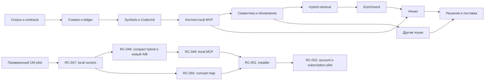

# Подробный план разработки

Дата плана: 13 октября 2026 года. Завершены документы, TS/JS CM/Harness prototype и настоящий 28-session A/B pilot. Экономия tokens/cost не подтвердилась; [итог](../docs/AB-RESULTS.md) сохраняет и failure, и ограничения. Local vector/compact prototype проверен новым A/B: −69,4% tokens, −56,9% расчётной цены, 12/16 против 9/16. В 0.5.0 MCP stdio, read-only CM Atlas и optional HNSW уже проверены; full backend, installer и подписка остаются планом. Этап закрывается результатом на указанной границе.

## Последовательность и критерии перехода

| Этап | Что получается | Зависимости | Условие готовности |
|---|---|---|---|
| M00 | Документы, контракты, план, переносимый probe | Исходный концепт | Навигация и документационные checks проходят |
| M00P | Local TS/JS CM и внешний Harness plugin | M00 probe | Runtime/packaging проверены; 224-file corpus и живой A/B pilot опубликованы |
| M01 | Целевой TypeScript corpus и 40 размеченных задач | M00 | Hashes, ground truth, holdout и TypeScript capabilities зафиксированы |
| M02 | Reader, blobs, ledger и restore | M01 contracts | Source roundtrip, стабильный manifest и реальная SQL/restore проверка |
| M03 | Глоссарий, CodeUnit и required context | M02 | Scope identity, exact partition, captures и крайние случаи проходят |
| M04 | Exact/text retrieval, package, CLI/API | M03 | Сквозной реальный поиск с источниками; A/B/C baseline измерен |
| M05 | Cross-file семантика, инвалидация и jobs | M04 | Capabilities честны; version fencing, recovery и обновления проверены |
| M06 | Embeddings, hybrid ranking и graph contribution | M04/M05 | D/E оценены при фиксированном corpus и budget |
| M07 | Bounded enrichment, admission, review | M05/M06 | Evidence и статусы проверены; качество живой модели измерено отдельно |
| M08 | Viewer, editor overlay, read-only integration | M04–M07 по задачам | Навигация, graph evidence и ContextPackage проверены через интерфейс |
| M09 | Python, C# и межсервисные contracts | Общий TS core M03/M05 | Языковые и межрепозиторные сценарии проходят на реальных версиях |
| M10 | Память решений, команда и следующая поставка | M07–M09 по задачам | Restore, access isolation, реальные UC и release proof выполнены |
| M11 | Local vector retrieval, MCP, world map и desktop delivery | M00P; зависимости задач | Компактный hybrid context измерен, реальный MCP client и viewer проверены, installer/entitlement имеют отдельный proof |

Минимальный полезный MVP заканчивается M04: один TypeScript-проект, точный и текстовый поиск, глоссарий, блоки и проверяемый пакет окружения. Core/CLI/API/workers пишутся на TypeScript + Node.js; API — Fastify, будущий viewer — React + TS. M05–M08 расширяют качество и удобство. Дополнительные языки и командный выпуск не задерживают первый локальный результат. Уже работающие npm-инструменты проверяют документы и ограниченную fixture; они не закрывают продуктовые этапы.

CM означает Code Memory. Plugin даёт bounded local index/query поверх JSON snapshot и уже проверен с живой моделью. M01–M04 доводят core до более широкого корпуса, ledger и полного ContextPackage API; pilot не закрывает 40-задачный benchmark. Compact auto context уже реализован; общий ContextService остаётся частью RC-033.

Ближайший путь продукта — RC-047/RC-048: локальные embeddings/SQLite/LanceDB и один компактный hybrid retrieve_context. RC-049 уже закрывает MCP stdio текущего core; RC-062 — Atlas prototype, RC-063 — HNSW. RC-050 развивает полноценную карту подтверждённых concepts/unresolved states. RC-051 проверяет installer/update, RC-052 — cloud account и signed entitlement с гипотезой $10/месяц. Модельный бюджет отделён от подписки. PostgreSQL/pgvector остаются вариантом team server; локальный клиент не ждёт всей серверной поставки. [Обоснование](../docs/LOCAL-PRODUCT.md).

## Критический путь

Точные зависимости заданы в [backlog](BACKLOG.md). Схема показывает этапы, а не требование выполнять всё одним большим изменением.

## Разбиение на первые reviewable изменения

1. **Corpus и правила версии.** Выбрать одну реальную задачу проекта, сохранить manifest и expected sources; зафиксировать spans и capabilities. Проверка: повторить manifest и ground truth.
2. **Source reader и blobs.** Реализовать один воспроизводимый снимок без анализа. Проверка: прочитать Git/overlay и восстановить bytes, включая deletion и CRLF.
3. **Symbols и CodeUnit.** Добавить TypeScript scopes через Compiler API, hierarchy и partition. Проверка: точный source плюс nested captures, shadowed locals и UTF-16→byte mapping.
4. **Ledger и exact navigation.** Для local product проверить SQLite, для team server — PostgreSQL. Проверка: реальные миграции, restore и переход к нужному source.
5. **ContextPackage.** Раскрыть required context с budget и omissions. Проверка: реальная задача с closure/guard и сравнение baseline.

Это рекомендуемые границы commits/PR, а не пять независимых серверов. Ближайшие точные действия перечислены в [первой итерации](FIRST-ITERATION.md).

## Правила закрытия задачи

- Есть воспроизводимый вход и точная source version.
- Результат проходит acceptance из backlog на ближайшей реальной границе.
- Опубликована capability или ограничение, если часть сценария не поддержана.
- Обновлены контракт, fixtures и затронутая документация.
- Новые ошибки и незавершённые результаты отражены явно.
- Состояния локальной проверки, commit, push, CI, provider и release различаются.

Green test не доказывает улучшения retrieval. Для такого утверждения требуется сравнение [EVALUATION](../docs/EVALUATION.md). Если вариант не улучшает метрику, он не принимается по обещанию будущей пользы.

## Роли и объём

Нужны роли core/backend, language analysis, retrieval/evaluation и interface. Один разработчик может выполнять их последовательно. Размеры S/M/L в backlog отражают относительную сложность, не обещают срок. Календарная оценка делается после M01 и spikes с учётом доступного состава и корпуса.

Провайдер для pilot уже выбран и проверен: GPT-6 Luna, одинаковый в обеих группах. Новый benchmark получает собственный protocol/holdout и учитывает retrieval/enrichment расходы. Hosted deployment, лицензия, платежи и team delivery решаются на своих этапах.

## После второго A/B

M00V / RC-053…RC-055 завершили local learned vectors, compact auto context и новый полный pilot. [Результат](../docs/HYBRID-RESULTS.md) сохраняет четыре CM failures, две baseline budget stops и более высокую latency. Ближайшее развитие — RC-056 provenance/scope/latency и RC-047 SQLite/FTS/native delivery; RC-048 расширяет retrieval/evaluation до общего API. Read-only MCP/Atlas prototype и optional HNSW уже доступны. Полный server/concept enrichment/installer/subscription продукт остаётся планом.
