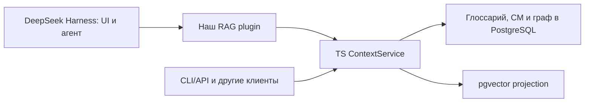

# DeepSeek Harness: основа оболочки, расширение или fork

Первое исследование выполнено 13 октября 2026 года по `deepseek-ai/deepseek-harness`, revision `d743267388641bc76f17c45ce8b4c231aed1d32c`. Ниже сохранены основания выбора. По последующему запросу пользователя реализован внешний CM plugin: runtime API закреплён на npm `@deepseek-ai/dsh-tools` 0.2.0-rc.2 и Cordis 4.0.4, а не на движущемся master/alpha. Инструкция и актуальные пределы — в [CM plugin](../docs/DEEPSEEK-PLUGIN.md). Fork не создаётся.

## Подтверждённые точки расширения

| Наблюдение | Первичный источник |
|---|---|
| Cordis plugins предоставляют services, typed events и registrations; agent loop и tool registry тоже заменяемы | [architecture.md](https://github.com/deepseek-ai/deepseek-harness/blob/d743267388641bc76f17c45ce8b4c231aed1d32c/docs/architecture.md) |
| Profiles/bundles и patch-конфигурация подключают внешние plugins; Web, headless и SDK являются отдельными профилями | [architecture.md](https://github.com/deepseek-ai/deepseek-harness/blob/d743267388641bc76f17c45ce8b4c231aed1d32c/docs/architecture.md) |
| `ctx.tools.register(defineTool(...))` добавляет инструмент; unload убирает registration. Canonical JSON result отделён от model rendering | [adding-a-tool.md](https://github.com/deepseek-ai/deepseek-harness/blob/d743267388641bc76f17c45ce8b4c231aed1d32c/docs/cookbook/adding-a-tool.md) |
| Context plugins добавляют model-visible сведения в историю; это сессионный контекст, а не версия исходного кода в нашем ledger | [context/README.md](https://github.com/deepseek-ai/deepseek-harness/blob/d743267388641bc76f17c45ce8b4c231aed1d32c/packages/context/README.md) |
| Root ESM; Node `^22.19.0 || >=24.0.0`, pnpm; build использует TypeScript | [package.json](https://github.com/deepseek-ai/deepseek-harness/blob/d743267388641bc76f17c45ce8b4c231aed1d32c/package.json) |
| Проект в developer preview с ожидаемыми несовместимыми изменениями | [README](https://github.com/deepseek-ai/deepseek-harness/blob/d743267388641bc76f17c45ce8b4c231aed1d32c/README.md) |

## Рекомендация для Rag Coding

Для готового coding agent разумно использовать Harness как оболочку. Собственную ценность проекта сохранить в независимом TS core: immutable snapshots, symbols/glossary, иерархическая CM, восстановление окружения, PostgreSQL ledger/граф и pgvector projection. Harness управляет агентским циклом, инструментами, моделями, сессиями и интерфейсом. Эти ответственности дополняют друг друга.

Предпочтительный первый эксперимент — внешний RAG plugin и отдельный профиль Harness. Он вызывает наш ContextService через typed interface или HTTP. Для других клиентов тот же core доступен через CLI/API и позднее MCP. Для минимального запуска можно использовать Web UI Harness, а специализированную навигацию по CM и графу добавлять отдельно. Это позволяет раньше проверить продукт без разработки собственной агентской оболочки.

## Сравнение вариантов

| Вариант | Когда подходит | Что нужно поддерживать |
|---|---|---|
| Внешний plugin + профиль | Имеющихся tools/context/UI extension points хватает | Core, adapter, version pin и совместимость с upstream |
| Минимальный fork + наш plugin | Реальный spike выявил необходимую точку, недоступную через extension API | Всё выше плюс конкретный ограниченный patch и upstream merge |
| Полная копия Harness с изменённым core | Продукт требует постоянных изменений агентского цикла, протокола или всей оболочки | Отдельную ветку развития большой системы; для текущего RAG-концепта пока не обосновано |

Формальный fork полезен для собственной дистрибуции, однако сама возможность fork не доказывает необходимость менять исходники Harness. Сначала стоит проверить расширение на закреплённой версии. В текущем Rag-Coding история Git сохраняется; переписывать её или заменять репозиторий upstream не требуется.

## Конкретный integration spike

1. Зафиксировать release или commit Harness, Node.js 24, версии package dependencies и разрешённый тестовый корпус. После реализации plugin общий минимум Node 22.19; для локальных проверок используется Node 24 LTS.
2. Зарегистрировать read-only `rag_symbol_search`, `rag_code_search`, `rag_context_get`, `rag_graph_expand`. Названия — проектное предложение, а не существующие встроенные tools. Проверить wire schemas, canonical values, cancellation и unload/reload.
3. Выполнить настоящий путь agent tool → ContextService → source bytes. Каждый ответ содержит snapshot, source hash, spans, omissions и причины выбора. Начать с явного tool call; автоматический context hook проверять отдельно.
4. Проверить dirty overlay, edit между запросами, недоступную projection, устаревшую связь и повтор после отмены. Сессионная история хранит выданный исторический контекст, но новая retrieval-операция получает явно выбранную актуальную версию. Harness compaction не удаляет факты из source ledger.
5. Для automatic context использовать документированные hooks с сохранением их порядка и retry semantics. Не перезаписывать уже зафиксированный model request и не добавлять полный индекс в каждый prompt.
6. Сравнить с базовыми file/text tools Harness на одинаковых задачах: успех правки, recall нужных dependencies, лишние токены, число вызовов и полную latency. Источники и budget одинаковые. Только после измерения утверждать выигрыш.
7. Если нужная операция недоступна, сохранить воспроизводимый failing case и конкретный patch proposal. Тогда решать вопрос о минимальном fork; до этого достаточно расширения.

Local prototype и внешний plugin выполнены в RC-043/RC-044. Общий ContextService, live model loop и автоматический context остаются RC-033. Production ledger/vector backend и 40-задачный corpus не реализованы; registry smoke не является проверкой качества RAG.
